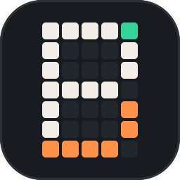
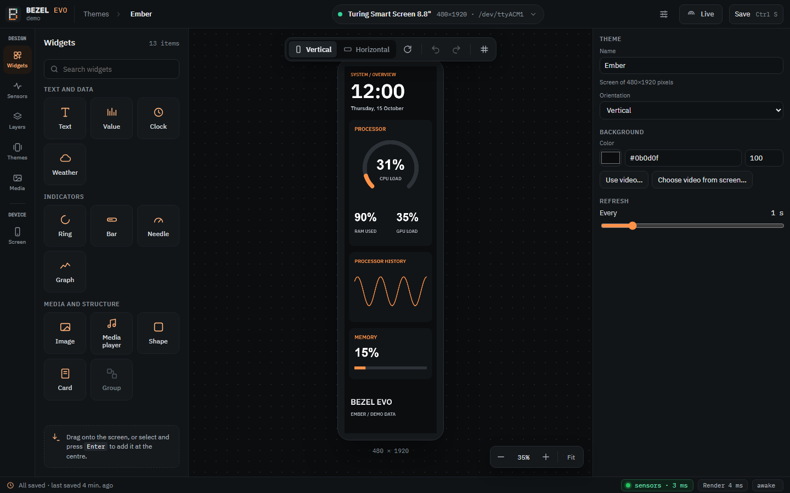
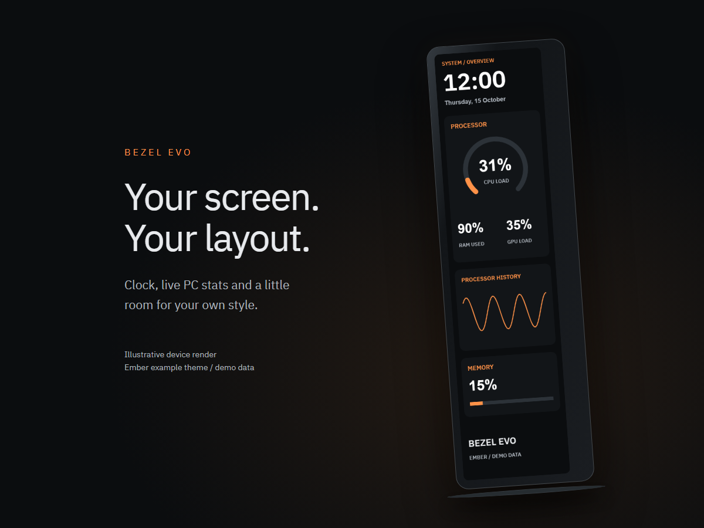
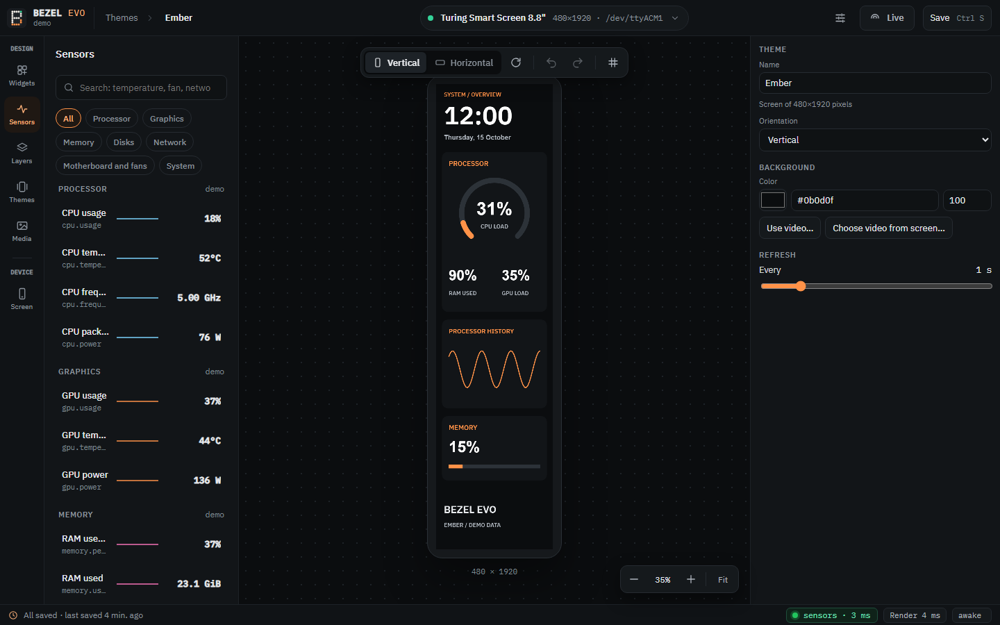
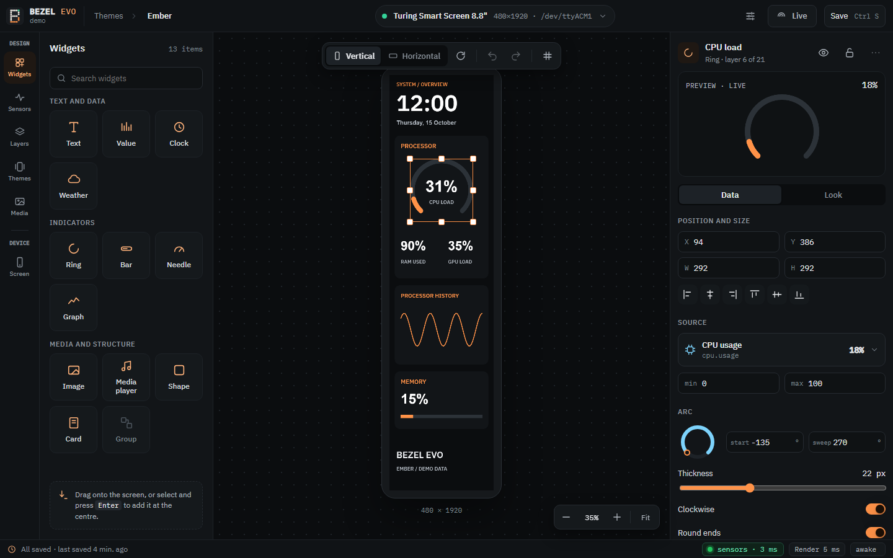
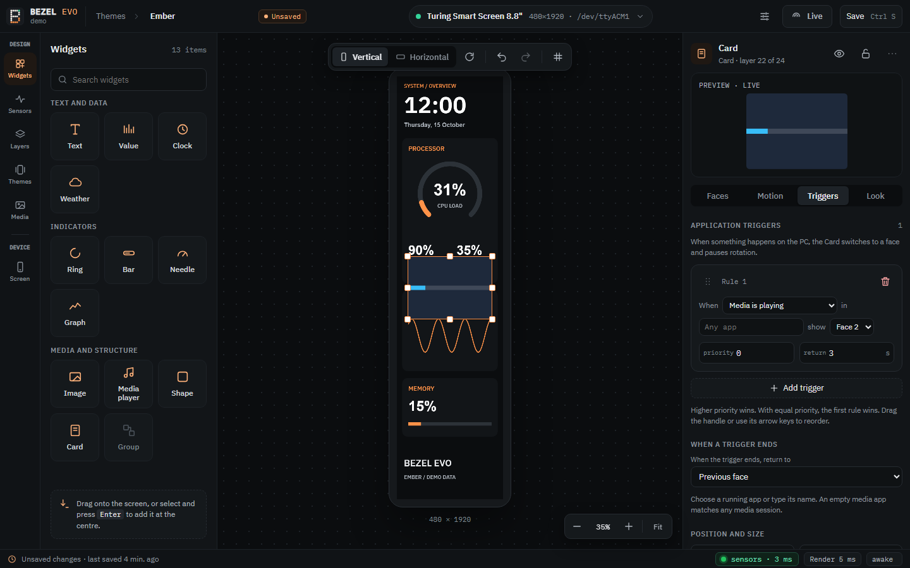
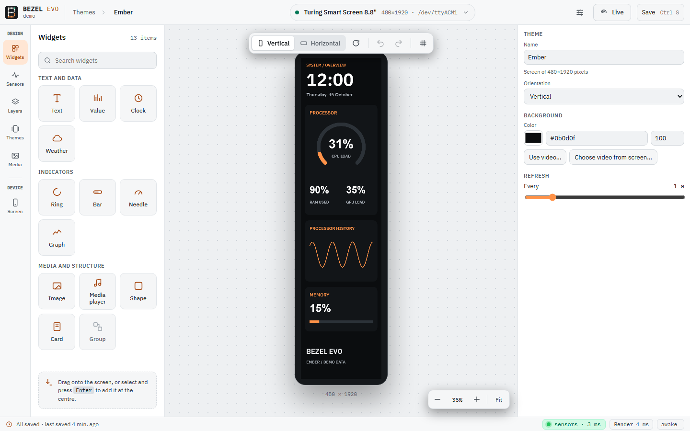

  

<h1 align="center">Bezel Evo</h1>

Make your USB smart screen your own.

  
  
  

Studio in demo mode. Example layout and simulated sensor readings.

See the example on a screen

## What it does

- **Design visually.** Drag widgets onto the canvas, then change their size, colours and fonts.
- **See your PC's stats.** Built-in CPU, GPU, memory and hardware monitoring, with a bundled sensor reader instead of a separate monitoring app to keep open.
- **Go beyond gauges.** Add clocks, weather, now-playing information and history graphs.
- **Make layouts react.** Cards switch faces with fade, slide or flip transitions, on a timer or in response to apps and media.
- **Run multiple screens.** Give each display its own theme and orientation.
- **Keep it running with Light.** Your saved themes stay on the screens while Studio is closed, with controls in the Windows tray.
- **Start from a theme.** Use bundled layouts, import supported themes, or save your own as a `.bezeltheme` file.

## Gallery

| Find your sensors | Fine-tune each widget |
| :---: | :---: |
|  |  |
| **Cards and triggers** | **Light theme** |
|  |  |

## Download & install

1. **[Open Releases](https://github.com/jripper77/bezel/releases)** and download the Windows x64 **Setup** or **portable ZIP**.
2. Close the screen's vendor app. Run Setup, or extract the ZIP into a writable folder. Setup offers optional hardware sensors and Light at sign-in.
3. Open **Studio**, select your screen, choose a theme, customise it and **Save**. Turn on **Live** to send it to the display.

**Requirements:** Windows 10/11 x64, a compatible USB smart screen and Microsoft Edge WebView2. Setup can download WebView2; portable Studio needs it already installed. Hardware sensors use .NET Framework 4.7.2 or newer; availability depends on your hardware and drivers. FFmpeg is separate for video conversion.

Windows preview packages are unsigned. See the [installation guide](packaging/windows/README.md) for sensor setup and updates.

## Supported screens

| Screen / family | Status |
| --- | --- |
| Turing Smart Screen 8.8" Rev C, ROM 1.90 | **Tested on hardware** |
| Other Turing Rev C models; Turing 3.5" / UsbPCMonitor 3.5" and 5" Rev A | Supported |
| XuanFang 3.5" / Flagship, Rev B | Supported |
| Kipye Qiye 3.5", Rev D | Supported |
| WeAct Studio Display FS 3.5" / 0.96" | Supported |
| TURZX / Turing USB generation, 1.6"-12.3" | Supported |
| WCH-based panels, 2.4"-4.3" | Supported |

"Supported" means a driver is implemented, not that every model or firmware has been physically tested. Check the [screen guide](docs/user/devices.md) and [full model catalogue](docs/reverse-engineering/devices.md) before choosing a display.

## Documentation

- [User guide](docs/user/README.md) / [Your first theme](docs/user/first-theme.md) / [Editing in Studio](docs/user/studio-editing.md)
- [Sensors](docs/user/sensors.md) / [Storage and video](docs/user/storage-and-video.md) / [Troubleshooting](docs/user/troubleshooting.md)
- [Technical documentation](docs/) / [Windows builds](docs/build-windows.md) / [Fork changes and validation](FORK.md)

## Credits & licence

Bezel Evo is a **fork of [slipalison/bezel](https://github.com/slipalison/bezel)**, created by [Alison Amorim (@slipalison)](https://github.com/slipalison). Original authorship, research and copyright notices are preserved.

Licensed under **[GPL-3.0-or-later](LICENSE)**. See [third-party credits and licences](THIRD_PARTY.md) for LibreHardwareMonitorLib, Tabler, Material Design Icons, IBM Plex and weather-data attribution.
