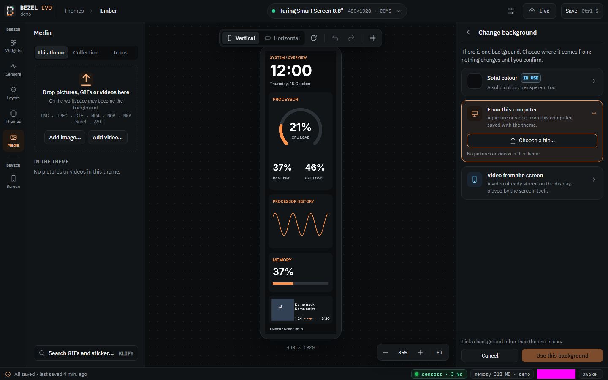

# O seu primeiro tema

[English](../first-theme.md)

Abra o **Bezel Studio** pelo menu Iniciar. A barra de cima mostra a tela em uso
(por exemplo *Turing Smart Screen 8.8" · 480×1920 · COM5*); clique nela para
escolher outra tela. Sem tela conectada, o Studio avisa e você pode editar mesmo
assim.


O Studio tem quatro áreas:

- a **barra de ícones**, bem à esquerda: **Widgets**, **Sensores**, **Camadas**,
  **Temas** e **Mídia** (Design), e **Tela** (Dispositivo);
- a **biblioteca** ao lado dela, com o painel que você escolheu na barra;
- a **área de edição** no meio, sobre uma grade de pontos, com barras flutuantes
  para a orientação, desfazer/refazer e as guias em cima e o zoom embaixo;
- o **inspetor** à direita: os ajustes do tema, ou os do objeto selecionado.

Arraste a borda entre duas áreas para alargar ou estreitar um painel. O que
aparece na edição é exatamente o que a tela vai receber: o desenho sai do mesmo
renderizador.

## 1. Comece por um tema

Clique em **Temas** na barra de ícones. O painel lista os seus temas e os
inclusos, cada um com uma miniatura desenhada com valores de exemplo e a tela
para a qual foi feito (por exemplo `8,8″ · 480×1920`). **Para esta tela** /
**Todos** e **Todos** / **Vertical** / **Horizontal** filtram a lista, e
**Buscar temas** acha um pelo nome.

- Clique num tema para abri-lo.
- **Novo tema** começa um tema vazio do tamanho da sua tela, **Vertical** ou
  **Horizontal**.
- **Abrir galeria de temas** mostra os mesmos temas numa janela maior, com
  **Duplicar** e **Abrir no editor**.
- **Importar…** converte o tema de outro aplicativo
  ([Temas de outros aplicativos](#temas-de-outros-aplicativos)).

## 2. Edite

- **Widgets**: texto, valor, relógio, clima, anel, barra, ponteiro, gráfico,
  imagem, player de mídia, forma, cartão e grupo, em três grupos com uma busca.
  Arraste um para a área de edição, ou selecione-o e pressione **Enter** para
  adicioná-lo no centro.
- **Sensores**: todos os sensores do seu PC, por categoria, com o valor atual e
  uma pequena linha de histórico. Arraste um sensor sobre um widget para ligá-lo,
  ou para um espaço vazio para criar um valor novo.
- Clique num objeto para editá-lo no **inspetor**: no alto fica uma prévia ao
  vivo do objeto sozinho, e depois os ajustes em duas abas, **Dados** (o que ele
  mostra: sensor, faixa, texto, janela de tempo) e **Aparência** (como ele é:
  cores, fonte, tamanho, cantos, transições).
- **Camadas**: ordene, oculte, trave, agrupe e renomeie objetos, e veja as faces
  dos seus cartões.
- **Mídia**: imagens, GIFs e vídeos do tema, a sua coleção e a biblioteca de
  ícones.

Desfazer é **Ctrl+Z** e refazer **Ctrl+Shift+Z**, também na barra da área de
edição. A roda do mouse dá zoom em volta do ponteiro e o botão do meio arrasta a
vista; **Ajustar** mostra a tela inteira. O guia
[Editing in Studio](../studio-editing.md) (em inglês) cobre todas as
ferramentas.

## 3. Mostre na tela

Clique em **Ao vivo** na barra de cima. A tela acompanha as suas mudanças
enquanto você edita. Clique em **Salvar** (**Ctrl+S**) para guardar o tema na
sua biblioteca.

Se a tela parar de receber quadros com o ao vivo ligado (um mau contato, uma
tela travada), o Bezel a conecta de novo sozinho e continua; veja
[A tela travou](troubleshooting.md#a-tela-travou--parou-de-responder).

**Fechar o Studio** passa o seu tema salvo para o **Bezel Light**, que o mantém
rodando pela bandeja: a imagem não pisca, os gráficos guardam o histórico e um
vídeo de fundo continua tocando. Se você fechar com mudanças não salvas, o
Studio pergunta antes; a tela então mostra o tema salvo. O menu do Light na
bandeja tem **Open Studio** e **Quit**. Para ele iniciar quando você entrar no
Windows, veja [Iniciar com o Windows](run-at-login.md).

## 4. Ajustes da tela

Clique em **Tela** na barra de ícones. Ela tem duas abas:

- **Ajustes**: a tela selecionada com o estado dela, **Brilho**, **Iniciar com o
  computador**, o que a tela faz [quando o computador desligar](power-off.md) e
  **Avançado** (devolver a tela ao modo próprio dela, reiniciá-la).
- **Armazenamento**: imagens e vídeos guardados na tela
  ([Armazenamento e vídeo](storage-and-video.md)).

## Um vídeo no fundo

1. Não selecione nada (clique numa parte vazia da área de trabalho): o inspetor
   mostra o tema. O cartão **Fundo** mostra o fundo em uso.
2. Clique em **Mudar o fundo…**. Três origens se abrem no inspetor: **Cor
   sólida**, **Do computador** (uma imagem ou um vídeo, salvos com o tema) e
   **Vídeo da tela** (um vídeo já guardado no display). Nada muda até você
   confirmar com **Usar este fundo**; cancelar ou Esc deixa tudo como estava.

   

3. Você também pode soltar um vídeo ou um GIF animado direto na área de edição:
   ele vira o fundo na hora. Ou adicione-o em **Mídia** (**Adicionar vídeo…**) e
   escolha **Usar como fundo** nele.

O Bezel copia o vídeo para dentro do tema e tira dele uma imagem parada, a
*imagem de capa*, recortada no formato do tema. Tirá-la precisa do ffmpeg
([Instalar o ffmpeg](ffmpeg.md)); sem ele o vídeo entra mesmo assim, sem imagem
de capa. Desfazer (Ctrl+Z) traz o fundo anterior de volta.

O que a tela faz com ele:

- Telas que tocam vídeo sozinhas (Turing rev C, como a de 8,8", e a geração
  Turing USB) repetem uma cópia guardada nelas, e o Bezel desenha o tema por
  cima. O cartão do fundo diz se a tela já guarda o vídeo; se não, **Abrir Tela
  › Armazenamento** leva a **Enviar para a tela**, que converte o vídeo para a
  tela (um GIF animado vira MP4) e o envia.
- As telas Turing rev C aceitam no máximo **25 MiB por arquivo**. A conversão
  baixa a taxa de bits conforme a duração do vídeo para ele caber, então um
  clipe longo perde um pouco de qualidade; se mesmo assim não couber, o Bezel
  avisa antes de enviar qualquer coisa
  ([Qual o tamanho máximo de um arquivo](storage-and-video.md#qual-o-tamanho-máximo-de-um-arquivo)).
- Telas que não tocam vídeo recebem o vídeo decodificado no computador, o que
  também precisa do ffmpeg.

Salvar o tema guarda o vídeo e a imagem de capa dentro do arquivo
`.bezeltheme`. Para girar, ampliar ou posicionar o vídeo, veja
[Enquadrar o vídeo](storage-and-video.md#enquadrar-o-vídeo).

## GIFs animados

Um GIF animado adicionado como **imagem** se mexe no ritmo dele, também entre as
atualizações do tema: até 30 quadros por segundo na tela, até 15 na edição. Os
sensores seguem a atualização do tema. Só o retângulo do GIF vai para a tela,
então um GIF pequeno (um logo, um ícone, uma animação de 240x240) se mexe suave.
Um GIF do tamanho da tela muda só na velocidade em que o USB leva quadros
inteiros (cerca de 2 por segundo na 8,8"): o Bezel então pula quadros para não
atrasar. Para uma animação de tela cheia, use o GIF como vídeo de fundo
([Um vídeo no fundo](#um-vídeo-no-fundo)): a própria tela o toca. Um GIF oculto
não se mexe.

## Temas de outros aplicativos

**Temas → Importar…** converte um tema do app do fabricante (`.turtheme`) ou do
turing-smart-screen-python (a pasta do tema ou o `theme.yaml`). O que não deu
para converter exatamente aparece numa lista depois da importação.

## O mesmo pela linha de comando

```powershell
bezel run turing-8.8-horizontal                       # um tema incluso, ao vivo, até Ctrl+C
bezel run "$HOME\Documents\meu.bezeltheme"            # um arquivo de tema
bezel render turing-8.8-vertical -o previa.png        # um quadro numa imagem, sem precisar da tela
bezel import AMD.turtheme -o amd.bezeltheme           # converte o tema de outro aplicativo
```

Um tema é um arquivo `.bezeltheme`: um zip com `theme.json` e uma pasta
`assets/`.
